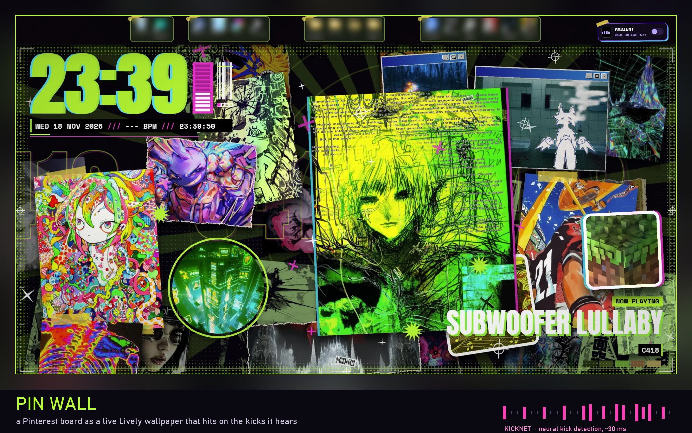
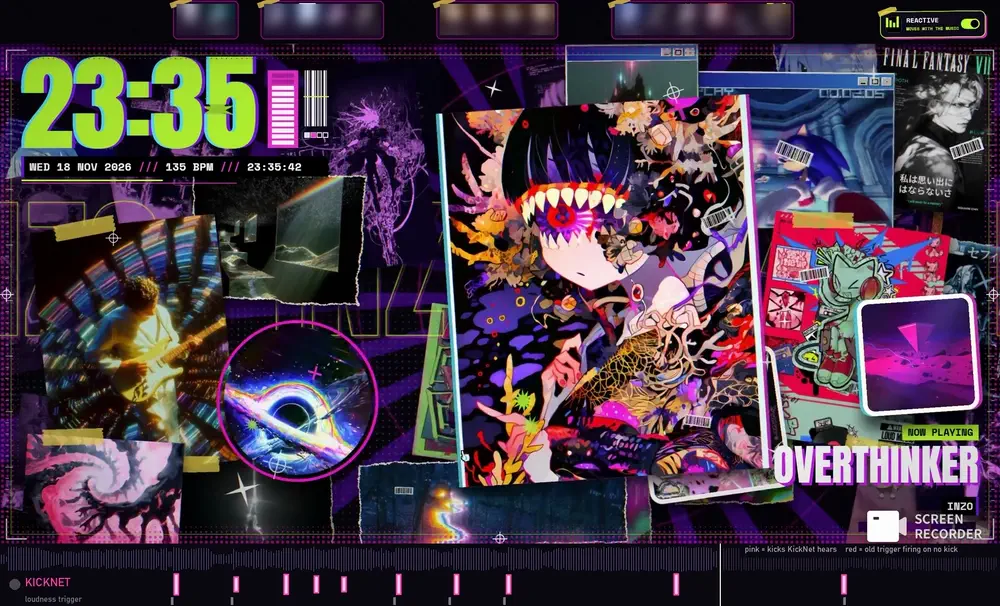

# Pin Wall

**A live Windows wallpaper made from your own images that hits on the kicks of whatever you're playing.**





**[▶ Watch the 50 s demo with sound](https://github.com/arbxe-42/pinwall-audioreactive-wallpaper/releases/download/demo-v1/pinwall-demo.mp4)**
· [smaller version (21 MB)](https://github.com/arbxe-42/pinwall-audioreactive-wallpaper/releases/download/demo-v1/pinwall-demo-web.mp4)

Pin Wall turns a folder of images (a Pinterest board, your art, screenshots, anything) into a living
collage on your desktop: cut, taped, torn and printed out of register. It floats on its own, reacts to
your mouse, shows the time and the track that's playing, and **hits on every kick of whatever your PC
plays**: Spotify, YouTube, games, anything. It runs inside
[Lively Wallpaper](https://www.rocksdanister.com/lively/), free on the Microsoft Store.

## Features

- **Hits on the kicks, not the volume.** A small background listener hears your PC's sound and runs
  **KickNet**, a tiny neural kick detector, so the wall punches, splits and glitches on the kick drum
  and ignores vocals, bass notes and sidechain pumping.
- **On time, even on Bluetooth.** Each hit is scheduled for the moment you *hear* it. Bluetooth
  speakers play ~250 ms late, and Pin Wall waits for them; a one-minute tap-along calibrates any device.
- **Kick tape:** a small strip in the corner shows the last few seconds of sound and every kick KickNet
  hears, scrolling into a playhead (Reactive mode only).
- **Drops shatter the wall** into a fresh collage, and a picture swaps on every bar.
- **Now playing:** the track title and album cover (from Windows' media controls), and the cover's
  colours pick which of your images come up.
- **Mouse:** pictures sit at different depths and slide with the cursor; hovering lifts one with a
  holo-foil shine; click for a starburst and shockwave; drag across a picture to rip it open.
- **Reactive / Ambient:** one button on the desktop (or Ctrl+Alt+W) switches to a calm mode that
  still floats and slowly rotates pictures but ignores the music.
- **Icon shelf:** keep your desktop icons in a row at the top and the collage stays out from under them.
- **Battery mode,** multiple monitors, animated GIFs, and every image in your folder gets its turn.
- **Private by design:** sound is analysed in memory only, never recorded, saved or sent anywhere;
  your images stay on your PC.

## Install

You need Windows 10 or 11, [Lively Wallpaper](https://www.rocksdanister.com/lively/) (open it once
after installing) and [Python 3.10+](https://www.python.org/downloads/) (tick "Add python.exe to PATH").

1. Download **[PinWall.zip](https://github.com/arbxe-42/pinwall-audioreactive-wallpaper/releases/latest/download/PinWall.zip)**
   and unzip it somewhere permanent, like `Documents\PinWall`.
2. Double-click **`Setup.bat`**. It installs the listener, asks for your image folder, adds Pin Wall to
   Lively on every screen, and offers to start it with Windows and to calibrate Bluetooth speakers.
3. Play some music and look at your desktop.

The full guide (changing images, controls, speaker delay, icon shelf, troubleshooting, uninstall) is
in [`share/README.md`](share/README.md), which also ships inside the zip.

## Controls

| What | How |
|---|---|
| Music on / off | The **REACTIVE / AMBIENT** button (top right of the desktop), **Ctrl+Alt+W**, or left-click the tray icon |
| Change images | Tray icon → right-click → *Change images…* |
| Speaker delay | Tray icon → right-click → *Calibrate speaker delay…* |
| Settings | Lively → Pin Wall → *Customise*: reaction intensity, clock, battery mode, vivid colours |

## How the music part works

```
your PC's sound ─▶ listener (Python, tray) ──websocket──▶ wallpaper (WebGL2 in Lively)
                   · KickNet: kicks                         · hits at the moment you hear them
                   · beat clock: tempo, bars                · swaps, glitches, shatter
                   · drop detector                          · clock, now playing, mouse
```

Most audio-reactive wallpapers react to loudness or a frequency spectrum, so they jump on anything
loud in the low end. Pin Wall listens for **kicks**:

- Every 10 ms the full mix becomes 40 log-spaced frequency bands. KickNet looks at the last 120 ms and
  answers "was there a kick 30 ms ago?". It's a 2-layer neural net running in numpy, ~0.15 ms per step.
- It was trained on 31 songs: the full mix went in, and the answers came from each song's separated
  drum stem ([demucs](https://github.com/facebookresearch/demucs)), with kick labels checked by ear. So it
  heard vocals, bass and synths during training but was never taught to hit on them.
- The hit is sent with its confidence, and the wall hits harder on the kicks it's sure about.

Scored on songs it never trained on:

| | kick accuracy (F1) | hits with no kick under them | hand-tapped kicks caught |
|---|---|---|---|
| loudness trigger (the usual approach) | 0.54 | 65 / min | 91% |
| **KickNet** | **0.83** | **~12 / min** | **96%** |

The training songs are trance, hardstyle, neurofunk, breakcore and EDM; other genres work but are less
tested.

## KickNet on its own

The detector is a standalone download too (numpy only): `python -m kicknet song.wav` lists every kick,
`python -m kicknet --live` shows kicks in whatever your PC plays, and `KickDetector` streams it in your
own code. See [`kicknet/README.md`](kicknet/README.md) or grab
[KickNet.zip](https://github.com/arbxe-42/pinwall-audioreactive-wallpaper/releases/tag/kicknet-v7).

## Repository

| Folder | What |
|---|---|
| `wallpaper/` | the Lively web wallpaper (WebGL2): collage, effects, clock, music client |
| `listener/` | the Python listener: loopback capture, KickNet, beat clock, drops, tray, websocket |
| `kicknet/` | the standalone kick detector |
| `bench/` | training and evaluation: stem labels, KickNet training, scoring against human taps |
| `tools/` | image import, packaging, the Kick Check labelling page, demo recording, editing and vertical reels |
| `share/`, `setup.ps1` | what ships in `PinWall.zip`: the user guide, installer, uninstaller |

Developer notes (architecture, every tuning decision and its numbers, gotchas) are in
[`HANDOFF.md`](HANDOFF.md). The author's own install is described in
[`docs/THIS_INSTALL.md`](docs/THIS_INSTALL.md).

## Credits

- Demo music: INZO, *Overthinker*; JPEGMAFIA, *1539 N. Calvert*.
- The images in the demo and in `wallpaper/pins/` are from the author's Pinterest board and belong to
  their artists. Pin Wall's download ships without images: bring your own, and only use art you're
  allowed to use.
- Built with Lively Wallpaper, demucs (for training labels), numpy, soundcard and websockets.

## License

MIT for the code (see [`LICENSE`](LICENSE)). Images are not covered by the license.
